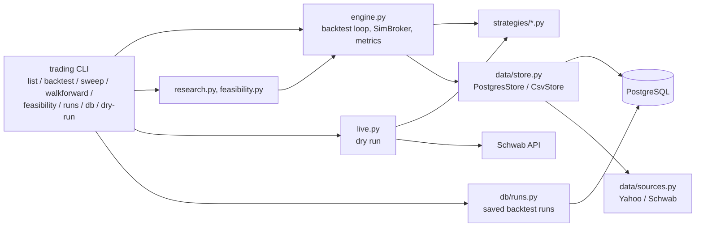
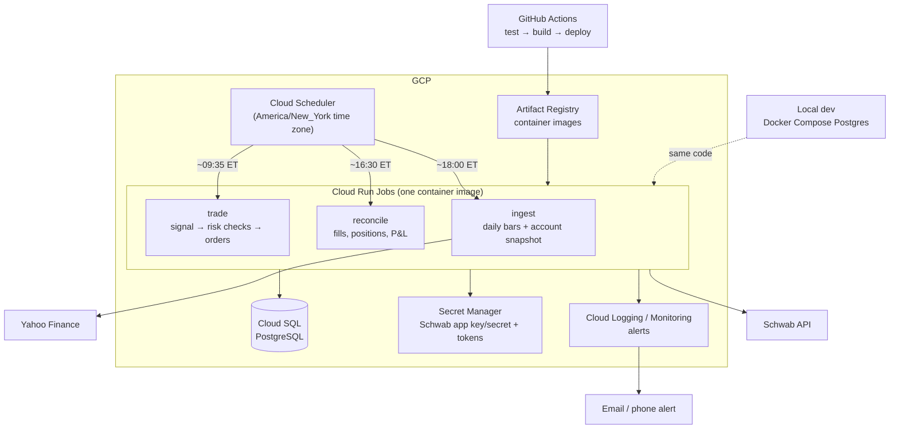
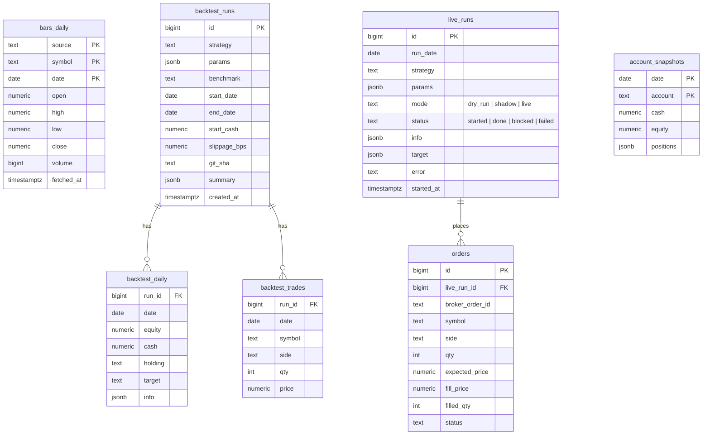

# Development Plan

Status as of 2026-11-13 (Phases A–C merged through PR #5). This plan covers how the project gets from a local backtesting tool to a scheduled trading system running on Google Cloud (GCP), with data stored in PostgreSQL.

**Guiding rule:** no real money goes into a strategy until it has passed the research gate (Phase C) and run in shadow mode for at least a month (Phase D).

---

## 1. Where we are

| Area | State |
|---|---|
| Strategy framework | One file per strategy in `strategies/`, loaded by name or path. Strategies see only past bars plus today's open (no look-ahead). |
| Backtesting | Daily bars, decide and fill at the open, value at the close. Whole shares, slippage, interest on idle cash (historical T-bill yield by default), benchmark comparison, metrics, CSV and PNG output. |
| Research tools | `sweep` (train/test split), `walkforward` (yearly re-tune vs. fixed params), `feasibility` (oracle / accuracy test), plus scripts in `research/`. |
| Data | Yahoo Finance (default) or Schwab daily bars, read through a cache: PostgreSQL when `DATABASE_URL` is set, otherwise CSV under `.cache/`. |
| Storage | PostgreSQL (local Docker; Cloud SQL later): `bars_daily`, `bar_coverage`, `backtest_runs/daily/trades`, managed with Alembic migrations. |
| Live | `dry-run` reads the Schwab account and prints the orders it *would* place. Nothing is sent. |
| Tests | 81 pytest tests, including a fake Schwab client and real-Postgres tests. CI runs lint, the format check and all tests. |
| Findings | See [RESEARCH.md](RESEARCH.md), Parts 1–6. VIX and every other indicator tested is a coin flip on direction. The **`vol_filter`** (UPRO while SPY's 20-day realized volatility is under 20%, else cash) is the candidate: about 90% of UPRO's return with half its drawdown (2015–2026). |

### Current architecture



---

## 2. Target architecture

### On GCP



**Why these services**

| Need | Choice | Reason |
|---|---|---|
| Run code on a schedule | **Cloud Run Jobs + Cloud Scheduler** | Batch jobs that run for seconds or minutes don't need an always-on server, so you pay only while a job runs. Scheduler supports the `America/New_York` time zone, so daylight-saving changes are handled for us. |
| Database | **Cloud SQL for PostgreSQL** | Standard open-source Postgres, managed for us (backups, patching). The alternative is self-managed Postgres on a small Compute Engine VM: cheaper, but backups and upgrades become our job. See open question 1. |
| Credentials | **Secret Manager** | Keeps keys out of the image and out of git. Also a home for the Schwab OAuth tokens (see "Schwab token lifecycle" below). |
| Images and deploys | **Artifact Registry + GitHub Actions** | The repo is already on GitHub. Tests gate every deploy. |
| Infrastructure | **Terraform** | The whole environment can be recreated from code. Sizing is small enough that this is quick to write. |
| Monitoring | **Cloud Logging + alert policies** | Alerts fire when a job fails, a job doesn't run, or a risk check blocks trading. |

### Code structure

```
trading/
  strategy.py        # unchanged: Strategy, MarketView, loader
  engine.py          # backtest loop + metrics (SimBroker moves to brokers/)
  config.py          # NEW: settings from env vars / Secret Manager (DATABASE_URL, mode, ...)
  data/
    sources.py       # Yahoo, Schwab fetchers (from data.py)
    store.py         # NEW: BarStore interface; CsvStore (tests/offline), PostgresStore
  db/
    models.py        # NEW: SQLAlchemy table definitions
    migrations/      # NEW: Alembic migrations
  brokers/
    base.py          # NEW: Broker interface: account(), place(orders), order_status()
    sim.py           # SimBroker (backtests)
    shadow.py        # NEW: records the orders it would send, simulates fills at real quotes
    schwab.py        # NEW: real order placement
  risk.py            # NEW: pre-trade checks (allocation cap, daily loss, kill switch)
  jobs/
    ingest.py        # NEW: Cloud Run Job entry points
    trade.py
    reconcile.py
  cli.py             # adds: `job <name>`, `sweep`, `runs`
strategies/          # unchanged
deploy/
  Dockerfile
  docker-compose.yml # local Postgres
  terraform/
```

Most of the change is around the edges: storage behind an interface, and brokers behind an interface. Strategy files don't change at all, so anything written today keeps working.

### Database schema (first version)



**Key constraints**
- `bars_daily` replaces the CSV cache. A separate `bar_coverage(source, symbol, start, end)` table replaces the `.json` sidecar files.
- `UNIQUE (run_date, strategy, mode)` on `live_runs` makes the trade job **idempotent**: a retried or doubled run on the same day can't trade twice.
- `git_sha` and `params` on every run mean any result can be reproduced later.
- Daily data is small (about 4,000 rows per symbol for 16 years), so plain Postgres is plenty and no time-series extension is needed.

### Daily schedule (all times ET, trading days only)

| Time | Job | What it does |
|---|---|---|
| 09:35 | `trade` | Checks the NYSE calendar and exits on holidays. Loads history from Postgres plus today's opens from Schwab quotes, runs the strategy, runs risk checks, then places orders (live), records them (shadow), or logs them (dry run). |
| 16:30 | `reconcile` | Pulls fills and positions from Schwab, writes `account_snapshots`, and compares actual fills with the expected open price (measured slippage). Alerts on any mismatch. |
| 18:00 | `ingest` | Appends today's daily bars for every symbol any active strategy uses. |

### Schwab token lifecycle (an operational constraint)

Schwab OAuth refresh tokens **expire every 7 days**, and getting a new one requires a person to log in through a browser. A scheduled cloud job can't do that by itself. The plan:

1. Store the token data in Secret Manager or Postgres instead of schwabdev's default local file (`~/.schwabdev/tokens.db`). Cloud Run containers are wiped after every run.
2. Add `python -m trading auth`, which you run locally once a week. It does the browser login and uploads the fresh tokens.
3. Alert two days before expiry. If the token has expired, the trade job fails safely (no orders) and alerts.

---

## 3. Next steps

Each phase ends in something usable. Phases B and C can run in parallel.

### Phase A: Housekeeping (½ day)

- [x] Commit the Phase 2 branch and open a PR.
- [x] Add `pyproject.toml` (package metadata, `ruff` lint/format config, `trading` command).
- [x] Add GitHub Actions CI: `ruff` + `pytest` on every push and PR.
- [x] Pin exact dependency versions: `uv.lock`, a single lock file valid on both macOS and Linux.

### Phase B: PostgreSQL persistence (2–3 days)

- [x] `deploy/docker-compose.yml` with Postgres 16 for local development (`trading` + `trading_test` databases).
- [x] `trading/config.py`: settings from environment variables (`DATABASE_URL`, `SCHWAB_*`; the old lowercase keys still work).
- [x] SQLAlchemy Core tables plus Alembic migrations, with `psycopg` 3 as the driver. `trading db upgrade|status`. Live-trading tables (`live_runs`, `orders`, `account_snapshots`) come with Phase D.
- [x] `BarStore` base with `PostgresStore` (default when `DATABASE_URL` is set) and `CsvStore` (tests and offline use).
- [x] Every backtest saved to `backtest_runs` / `backtest_daily` / `backtest_trades`, with the git commit, params and both equity curves.
- [x] `trading runs list|show` lists and compares saved runs, and `--plot` overlays their equity curves.
- [x] `trading db import-csv` for the one-time import of `.cache/`.
- [x] Integration tests against a real Postgres: local Docker, and a CI service container where they're required (never skipped). Includes a test that fails if `models.py` and the migrations drift apart.

### Phase C: Research gate (ongoing, start now)

This decides whether anything goes live.

- [x] `trading sweep`: run a grid of params with a train/test split, ranked on train results only (default 5 bps slippage). Sweep results aren't stored in Postgres yet; chosen candidates are saved with `backtest`.
- [x] First research round: see [RESEARCH.md](RESEARCH.md). The original `spy_vix` fails; `vix_gap` was an interim candidate, superseded by `vol_filter`.
- [x] Feasibility (oracle) test, traditional-indicator screen, intraday-exit study, and options indicators: RESEARCH.md Parts 1, 3, 4 and 6.
- [ ] **GEX-based position sizing for `vol_filter`.** Parked on 2026-11-13; full brief in [section 3a](#3a-parked-gex-based-position-sizing) below.
- [ ] Decide the objective: Sharpe, or growth subject to a drawdown limit (see RESEARCH.md). **This blocks the gate below.** `vol_filter` ties SPY's Sharpe over 2010–2026 (0.84 vs 0.84) but trails it over 2015–2026 (0.74 vs 0.81), so it passes only under a growth-with-drawdown-limit objective.
- [x] Credit interest on idle cash (`--cash-rate`, default: historical T-bill yield).
- [x] `trading walkforward`: re-tune yearly on prior data, trade the next year; compare with fixed settings. Finding: yearly re-tuning hurts, so use fixed params.
- [x] Candidate for Phase D: `vol_filter` with fixed defaults (20-day / 20%). See RESEARCH.md Part 5.
- [ ] Breakdowns by market regime (2010–14, 2015–19, 2020, 2021, 2022, 2023+).
- [ ] Realistic costs: default `--slippage-bps` from measured live slippage once Phase D produces data.
- [ ] Additional metrics: Sortino, Calmar, worst month, longest drawdown, turnover.
- [ ] **Gate:** a strategy qualifies for shadow trading only if it beats buy-and-hold SPY on a risk-adjusted basis (Sharpe or Calmar) *out of sample*, with costs included.

### Phase D: Execution layer (3–5 days)

- [ ] `Broker` interface; move `SimBroker` behind it.
- [ ] `ShadowBroker`: writes the intended orders to `orders`, simulating fills at the real quote at order time. This is our "paper trading", since Schwab has no paper-trading API.
- [ ] `SchwabBroker`: market orders (or marketable limit orders) via `place_order`, polling `order_details` until filled.
- [ ] `risk.py` pre-trade checks:
  - Maximum dollars allocated to the strategy (**never** the whole account, as the original script did).
  - Maximum order size, and a stop if the account has dropped more than X% that day.
  - A kill switch (a database flag or environment variable) that blocks all orders.
  - Refuse to trade on stale data (today's open quote missing or obviously wrong).
- [ ] Idempotent `trade` job using the `live_runs` uniqueness rule.
- [ ] Job entry points: `python -m trading job trade|reconcile|ingest`.
- [ ] Token storage plus the `auth` command (see the Schwab token lifecycle section).
- [ ] Tests for every job against the fake Schwab client and a Postgres container.
- [ ] **Options collector job** (`job collect-options`, about 09:35 ET): snapshot SPY's 0-DTE and next-expiry option chains from Schwab `option_chains` into Postgres, and compute the ATM straddle (expected move) and our own GEX estimate. It builds the first-hand history that the free proxies in RESEARCH.md Part 6 can only approximate, and it gives a fallback GEX source (see section 3a, data risk). Start it early: its value grows with every day collected.

### Phase E: GCP deployment (2–3 days)

- [ ] `deploy/Dockerfile` (slim Python image, runs as a non-root user).
- [ ] Terraform for:
  - the project and APIs, Artifact Registry, Cloud SQL (Postgres, private IP, automated backups);
  - Secret Manager entries, a service account with least-privilege roles;
  - three Cloud Run Jobs and three Cloud Scheduler triggers;
  - log-based alert policies.
- [ ] GitHub Actions deploy workflow (on merge to `main`): test → build → push → update jobs → run migrations. Authenticate with Workload Identity Federation, not a stored key file.
- [ ] Alerts:
  - a job failed;
  - the `trade` job didn't finish by 09:45 ET;
  - a risk check blocked an order;
  - the token expires within 2 days;
  - the reconcile job found a mismatch.
- [ ] Runbook in `docs/`: re-authenticate Schwab, flip the kill switch, re-run a job, restore the database.

### Phase F: Go live, gradually

1. **Dry run** on GCP for 1–2 weeks: the jobs run, nothing is recorded as trades. Verify the schedule, holiday handling and alerts.
2. **Shadow** for at least 1 month: compare shadow results with what a backtest says for the same days. They should match closely, and any gap is a bug or a cost we haven't modeled.
3. **Live with a small, fixed allocation** and the risk limits on. Review weekly.
4. Increase the allocation only after live results track the shadow and backtest results.

---

## 3a. Parked: GEX-based position sizing

*Parked 2026-11-13. This is a self-contained brief for resuming the work later. Background: [RESEARCH.md Part 6](RESEARCH.md#part-6-options-market-indicators-gamma-exposure-and-expected-move-2026-11-13).*

### Why this is worth testing

Part 6 found that the previous day's **negative GEX** (dealers short gamma) is a strong, consistent forecaster of *how much* SPY moves the next day:

- the next day's average |move| was about 2.2x larger (train 1.29% vs 0.57%; test 1.61% vs 0.72%);
- the worst-5% day was about 2x worse;
- it carries information beyond realized volatility: even in calm markets, negative-GEX days moved 1.05% vs 0.57%.

But those same days had **positive** average next-day returns (+0.22% train, +0.08% test), with sharp rebounds. As a result, *exiting* on negative GEX (an on/off switch) lowered returns without consistently reducing drawdowns.

**The hypothesis:** *reducing* UPRO exposure on negative-GEX days, rather than exiting, keeps part of the rebound while cutting the outsized risk, improving `vol_filter`'s risk-adjusted return and drawdown. This is volatility targeting: if risk is about 2.2x normal, holding about 1/2.2 ≈ 0.5 of the position keeps risk roughly constant.

### Pre-registered test (decide these before looking at results)

| Item | Value |
|---|---|
| Baseline | `vol_filter` with fixed defaults (window 20, threshold 0.20, cash when off) |
| Hypothesis value | `gex_weight = 0.5`, chosen a priori from the 2.2x volatility ratio, *not* tuned |
| Neighbors (robustness) | `gex_weight` ∈ {0, 0.25, 0.33, 0.5, 0.75, 1.0}; 1.0 = baseline, 0 = the on/off switch already tested |
| Trigger | Primary: yesterday's GEX < 0. Secondary: yesterday's GEX below its trailing 252-day 20th percentile. GEX dollar levels have grown about 5x since 2011, but the sign is scale-free. |
| Periods | Train **2011-06-01 – 2019-12-31** (GEX data begins May 2011). Test 2020-01-01 → latest. Walk-forward from 2015. **Rerun the baseline from the same start date**; the Part 5 numbers start in 2010 and aren't directly comparable. |
| Costs | 5 bps per fill, T-bill interest on cash (defaults). Report trade count: GEX sign flips add rebalances. |

**Success criteria (all must hold):**

1. `gex_weight = 0.5` beats the baseline on **both Sharpe and max drawdown** in **both** train and test.
2. The neighbors 0.33 and 0.75 also beat the baseline on Sharpe in both periods. If only one exact value works, it's noise.
3. In walk-forward from 2015, fixed `gex_weight = 0.5` beats the fixed baseline.
4. Stretch goal: it clears the Phase C gate (beats buy-and-hold SPY's Sharpe out of sample). That would be the first strategy to do so.

If 1–3 fail, record the result in RESEARCH.md and close the idea, as was done for VIX.

### Implementation steps

1. **Data source for GEX** in `trading/data/sources.py`: a `SqueezeMetricsSource` (name `"squeezemetrics"`) that downloads `https://squeezemetrics.com/monitor/static/DIX.csv`. Reuse `load_gex()` from `research/options_indicators.py`. Use `requests`, not `urllib`: python.org's macOS Python has no root certificates.
   - Return a bars-shaped DataFrame for the canonical symbol `"GEX"`, with the GEX value in `close` and `open` (and `high`/`low` `NaN`, `volume` 0), so it flows through `CsvStore`/`PostgresStore` and `bars_daily` unchanged.
   - Since GEX is an **end-of-day** value, strategies must read it only through `view.history("GEX", 1)["close"]` (yesterday's value), never `view.open("GEX")`. Put this in the docstring and test it.
2. **Routing:** strategies need SPY/UPRO from Yahoo *and* GEX from SqueezeMetrics. Add a small `RoutingSource` (symbol → source; `name` per symbol) or let `load_market()` in `trading/cli.py` load `GEX` from its own store and merge it into `bars`. Whichever you choose, each bar store must be keyed by the *real* source name, because `bars_daily` uses `(source, symbol, date)` as its key.
3. **Calendar alignment:** GEX dates should match NYSE sessions. `run_backtest` only simulates dates where *all* of a strategy's symbols have bars, so any missing GEX date silently drops a trading day. Either forward-fill GEX onto SPY's dates in the source, or count the dropped days and fail loudly if there are more than a handful.
4. **Strategy:** extend `strategies/vol_filter.py` with params `gex_weight` (default **1.0**, meaning off, so the candidate's behavior is unchanged), `gex_rule` (`"sign"` | `"pct20"`) and `gex_symbol` (default `"GEX"`). When the filter is on and the GEX rule triggers, return `{long: gex_weight}`; the remainder stays in cash and earns interest. Only require `GEX` in `required_symbols()` when `gex_weight != 1.0`. Otherwise the default `vol_filter` would need GEX data and lose its 2010 start.
5. **Tests** (in `tests/test_vol_filter.py`):
   - the GEX rule reads only yesterday's value;
   - the weight is applied only when the volatility filter is on;
   - `gex_weight=1.0` reproduces today's `vol_filter` exactly, on the same bars;
   - `pct20` uses a trailing window only;
   - the source parses the CSV format (`date,price,dix,gex`), using a small fixture, not the network.

### Commands to run once implemented

```sh
uv run trading backtest -s vol_filter --start 2011-06-01 --label "baseline from 2011-06"
uv run trading backtest -s vol_filter -p gex_weight=0.5 --start 2011-06-01 --label "gex_weight 0.5 (pre-registered)"
uv run trading sweep -s vol_filter --start 2011-06-01 -g gex_weight=0,0.25,0.33,0.5,0.75,1.0 -g gex_rule=sign,pct20
uv run trading walkforward -s vol_filter --start 2011-06-01 -g gex_weight=0,0.25,0.33,0.5,0.75,1.0 \
    --reference gex_weight=1.0 --reference gex_weight=0.5 --plot docs/img/vol_filter_gex_walkforward.png
uv run trading runs show <baseline id> <gex id> --plot docs/img/vol_filter_gex.png
```

Then write the result up as RESEARCH.md Part 7, whether it passes or fails.

### Risks to resolve before trading it live

- **Data dependency.** SqueezeMetrics is a free third-party feed with no service guarantee, and its GEX is a *model estimate* whose history may have been revised. Before relying on it: check when each day's value is published (it must be available before 09:30 ET the next morning), and keep our own copy in Postgres. The Phase D options collector, which computes our own GEX from Schwab chains, is the long-term replacement. Compare the two once the collector has a few months of data.
- **The 0-DTE era.** 0-DTE volume has exploded since 2022, and end-of-day GEX may miss intraday 0-DTE hedging flows. Look at the 2023+ subperiod separately.
- **Extra turnover.** Partial positions mean more rebalances (GEX was negative on 7–11% of days). Confirm that costs don't consume the benefit.

---

## 4. Open questions

1. **Cloud SQL or Postgres on a VM?** Cloud SQL is managed, with backups and patching, and costs a fixed monthly amount. The smallest instances run on the order of $10–30/month, so check current pricing. A small Compute Engine VM running Postgres is cheaper but self-managed. **Recommendation: Cloud SQL**, because database maintenance for a trading system is not where your time should go.
2. **Which strategy goes to shadow first?** This depends on Phase C. The original `spy_vix` with SPXU doesn't qualify on current evidence.
3. **Alert channel:** email, SMS or a push service?
4. **Allocation and risk limits:** what dollar cap and what daily loss limit?
5. **Market or limit orders at the open?** Market orders fill reliably but with more slippage. Marketable limit orders give price protection at the risk of no fill. Phase D's reconcile data will show which works better.
