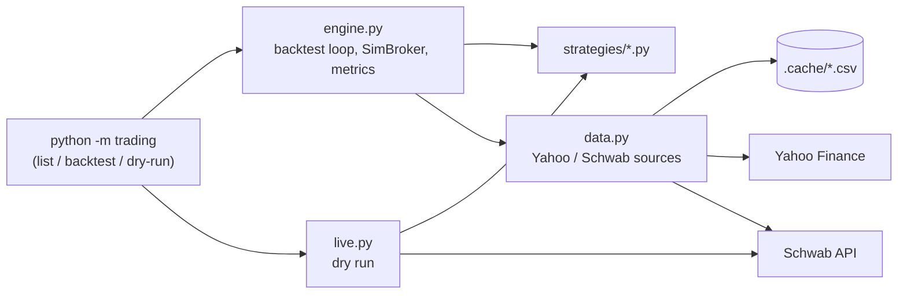
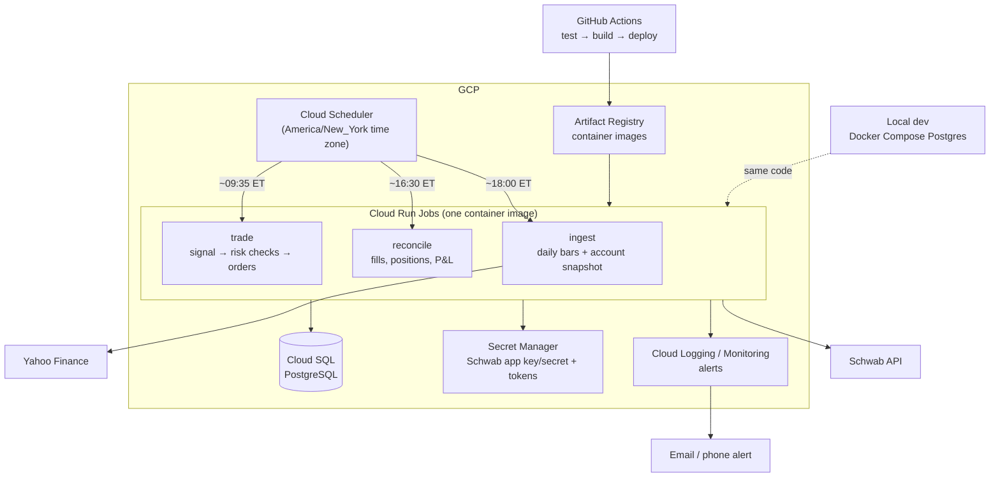
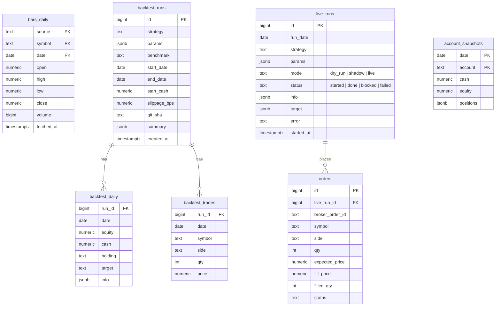

# Development Plan

Status as of 2026-11-12. This plan covers how the project gets from a local backtesting tool to a scheduled trading system running on Google Cloud (GCP), with data stored in PostgreSQL.

**Guiding rule:** no real money goes into a strategy until it has passed the research gate (Phase C) and run in shadow mode for at least a month (Phase D).

---

## 1. Where we are

| Area | State |
|---|---|
| Strategy framework | One file per strategy in `strategies/`, loaded by name or path. Strategies see only past bars plus today's open (no look-ahead). |
| Backtesting | Daily bars, decide and fill at the open, value at the close. Whole shares, slippage, benchmark comparison, metrics, CSV and PNG output. |
| Data | Yahoo Finance (default) or Schwab daily bars, cached as CSV under `.cache/`. |
| Live | `dry-run` reads the Schwab account and prints the orders it *would* place. Nothing is sent. |
| Tests | 32 pytest tests, including a fake Schwab client. |
| Findings | The original `spy_vix` lost 91% over 2010–2026 because of the short (SPXU) side. Long-only variants and `sma_trend` beat SPY on total return but not on risk-adjusted return. |

### Current architecture



---

## 2. Target architecture

### On GCP



**Why these services**

| Need | Choice | Reason |
|---|---|---|
| Run code on a schedule | **Cloud Run Jobs + Cloud Scheduler** | Batch jobs that run for seconds or minutes don't need an always-on server, so you pay only while a job runs. Scheduler supports the `America/New_York` time zone, so daylight-saving changes are handled for us. |
| Database | **Cloud SQL for PostgreSQL** | Standard open-source Postgres, managed for us (backups, patching). The alternative is self-managed Postgres on a small Compute Engine VM: cheaper, but backups and upgrades become our job. See open question 1. |
| Credentials | **Secret Manager** | Keeps keys out of the image and out of git. Also a home for the Schwab OAuth tokens (see "Schwab token lifecycle" below). |
| Images and deploys | **Artifact Registry + GitHub Actions** | The repo is already on GitHub. Tests gate every deploy. |
| Infrastructure | **Terraform** | The whole environment can be recreated from code. Sizing is small enough that this is quick to write. |
| Monitoring | **Cloud Logging + alert policies** | Alerts fire when a job fails, a job doesn't run, or a risk check blocks trading. |

### Code structure

```
trading/
  strategy.py        # unchanged: Strategy, MarketView, loader
  engine.py          # backtest loop + metrics (SimBroker moves to brokers/)
  config.py          # NEW: settings from env vars / Secret Manager (DATABASE_URL, mode, ...)
  data/
    sources.py       # Yahoo, Schwab fetchers (from data.py)
    store.py         # NEW: BarStore interface; CsvStore (tests/offline), PostgresStore
  db/
    models.py        # NEW: SQLAlchemy table definitions
    migrations/      # NEW: Alembic migrations
  brokers/
    base.py          # NEW: Broker interface: account(), place(orders), order_status()
    sim.py           # SimBroker (backtests)
    shadow.py        # NEW: records the orders it would send, simulates fills at real quotes
    schwab.py        # NEW: real order placement
  risk.py            # NEW: pre-trade checks (allocation cap, daily loss, kill switch)
  jobs/
    ingest.py        # NEW: Cloud Run Job entry points
    trade.py
    reconcile.py
  cli.py             # adds: `job <name>`, `sweep`, `runs`
strategies/          # unchanged
deploy/
  Dockerfile
  docker-compose.yml # local Postgres
  terraform/
```

Most of the change is around the edges: storage behind an interface, and brokers behind an interface. Strategy files don't change at all, so anything written today keeps working.

### Database schema (first version)



**Key constraints**
- `bars_daily` replaces the CSV cache. A separate `bar_coverage(source, symbol, start, end)` table replaces the `.json` sidecar files.
- `UNIQUE (run_date, strategy, mode)` on `live_runs` makes the trade job **idempotent**: a retried or doubled run on the same day can't trade twice.
- `git_sha` and `params` on every run mean any result can be reproduced later.
- Daily data is small (about 4,000 rows per symbol for 16 years), so plain Postgres is plenty and no time-series extension is needed.

### Daily schedule (all times ET, trading days only)

| Time | Job | What it does |
|---|---|---|
| 09:35 | `trade` | Checks the NYSE calendar and exits on holidays. Loads history from Postgres plus today's opens from Schwab quotes, runs the strategy, runs risk checks, then places orders (live), records them (shadow), or logs them (dry run). |
| 16:30 | `reconcile` | Pulls fills and positions from Schwab, writes `account_snapshots`, and compares actual fills with the expected open price (measured slippage). Alerts on any mismatch. |
| 18:00 | `ingest` | Appends today's daily bars for every symbol any active strategy uses. |

### Schwab token lifecycle (an operational constraint)

Schwab OAuth refresh tokens **expire every 7 days**, and getting a new one requires a person to log in through a browser. A scheduled cloud job can't do that by itself. The plan:

1. Store the token data in Secret Manager or Postgres instead of schwabdev's default local file (`~/.schwabdev/tokens.db`). Cloud Run containers are wiped after every run.
2. Add `python -m trading auth`, which you run locally once a week. It does the browser login and uploads the fresh tokens.
3. Alert two days before expiry. If the token has expired, the trade job fails safely (no orders) and alerts.

---

## 3. Next steps

Each phase ends in something usable. Phases B and C can run in parallel.

### Phase A: Housekeeping (½ day)

- [x] Commit the Phase 2 branch and open a PR.
- [x] Add `pyproject.toml` (package metadata, `ruff` lint/format config, `trading` command).
- [x] Add GitHub Actions CI: `ruff` + `pytest` on every push and PR.
- [x] Pin exact dependency versions: `uv.lock`, a single lock file valid on both macOS and Linux.

### Phase B: PostgreSQL persistence (2–3 days)

- [ ] `deploy/docker-compose.yml` with Postgres 16 for local development.
- [ ] `trading/config.py`: settings from environment variables (`DATABASE_URL`, etc.).
- [ ] SQLAlchemy models plus Alembic migrations for the schema above. Use `psycopg` 3 as the driver.
- [ ] `BarStore` interface with `PostgresStore` (default when `DATABASE_URL` is set) and `CsvStore` (tests and offline use).
- [ ] Save every backtest to `backtest_runs` / `backtest_daily` / `backtest_trades`.
- [ ] `python -m trading runs` lists and compares saved runs.
- [ ] One-time import of the existing `.cache/` CSVs.
- [ ] Integration tests against a throwaway Postgres (testcontainers or a CI service container).

### Phase C: Research gate (ongoing, start now)

This decides whether anything goes live.

- [ ] `python -m trading sweep`: run a grid of params, with results stored in Postgres.
- [ ] Walk-forward evaluation: tune on years N…N+k, test on the following year, and roll forward.
- [ ] Breakdowns by market regime (2010–14, 2015–19, 2020, 2021, 2022, 2023+).
- [ ] Realistic costs: default `--slippage-bps` from measured live slippage once Phase D produces data.
- [ ] Additional metrics: Sortino, Calmar, worst month, longest drawdown, turnover.
- [ ] **Gate:** a strategy qualifies for shadow trading only if it beats buy-and-hold SPY on a risk-adjusted basis (Sharpe or Calmar) *out of sample*, with costs included.

### Phase D: Execution layer (3–5 days)

- [ ] `Broker` interface; move `SimBroker` behind it.
- [ ] `ShadowBroker`: writes the intended orders to `orders`, simulating fills at the real quote at order time. This is our "paper trading", since Schwab has no paper-trading API.
- [ ] `SchwabBroker`: market orders (or marketable limit orders) via `place_order`, polling `order_details` until filled.
- [ ] `risk.py` pre-trade checks:
  - Maximum dollars allocated to the strategy (**never** the whole account, as the original script did).
  - Maximum order size, and a stop if the account has dropped more than X% that day.
  - A kill switch (a database flag or environment variable) that blocks all orders.
  - Refuse to trade on stale data (today's open quote missing or obviously wrong).
- [ ] Idempotent `trade` job using the `live_runs` uniqueness rule.
- [ ] Job entry points: `python -m trading job trade|reconcile|ingest`.
- [ ] Token storage plus the `auth` command (see the Schwab token lifecycle section).
- [ ] Tests for every job against the fake Schwab client and a Postgres container.

### Phase E: GCP deployment (2–3 days)

- [ ] `deploy/Dockerfile` (slim Python image, runs as a non-root user).
- [ ] Terraform for:
  - the project and APIs, Artifact Registry, Cloud SQL (Postgres, private IP, automated backups);
  - Secret Manager entries, a service account with least-privilege roles;
  - three Cloud Run Jobs and three Cloud Scheduler triggers;
  - log-based alert policies.
- [ ] GitHub Actions deploy workflow (on merge to `main`): test → build → push → update jobs → run migrations. Authenticate with Workload Identity Federation, not a stored key file.
- [ ] Alerts:
  - a job failed;
  - the `trade` job didn't finish by 09:45 ET;
  - a risk check blocked an order;
  - the token expires within 2 days;
  - the reconcile job found a mismatch.
- [ ] Runbook in `docs/`: re-authenticate Schwab, flip the kill switch, re-run a job, restore the database.

### Phase F: Go live, gradually

1. **Dry run** on GCP for 1–2 weeks: the jobs run, nothing is recorded as trades. Verify the schedule, holiday handling and alerts.
2. **Shadow** for at least 1 month: compare shadow results with what a backtest says for the same days. They should match closely, and any gap is a bug or a cost we haven't modeled.
3. **Live with a small, fixed allocation** and the risk limits on. Review weekly.
4. Increase the allocation only after live results track the shadow and backtest results.

---

## 4. Open questions

1. **Cloud SQL or Postgres on a VM?** Cloud SQL is managed, with backups and patching, and costs a fixed monthly amount. The smallest instances run on the order of $10–30/month, so check current pricing. A small Compute Engine VM running Postgres is cheaper but self-managed. **Recommendation: Cloud SQL**, because database maintenance for a trading system is not where your time should go.
2. **Which strategy goes to shadow first?** This depends on Phase C. The original `spy_vix` with SPXU doesn't qualify on current evidence.
3. **Alert channel:** email, SMS or a push service?
4. **Allocation and risk limits:** what dollar cap and what daily loss limit?
5. **Market or limit orders at the open?** Market orders fill reliably but with more slippage. Marketable limit orders give price protection at the risk of no fill. Phase D's reconcile data will show which works better.
