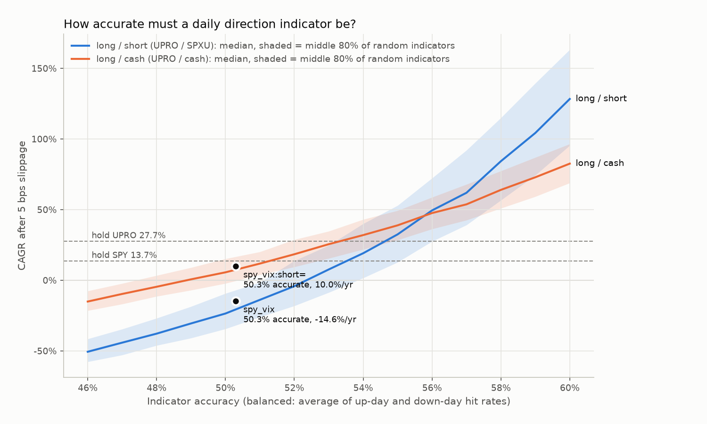
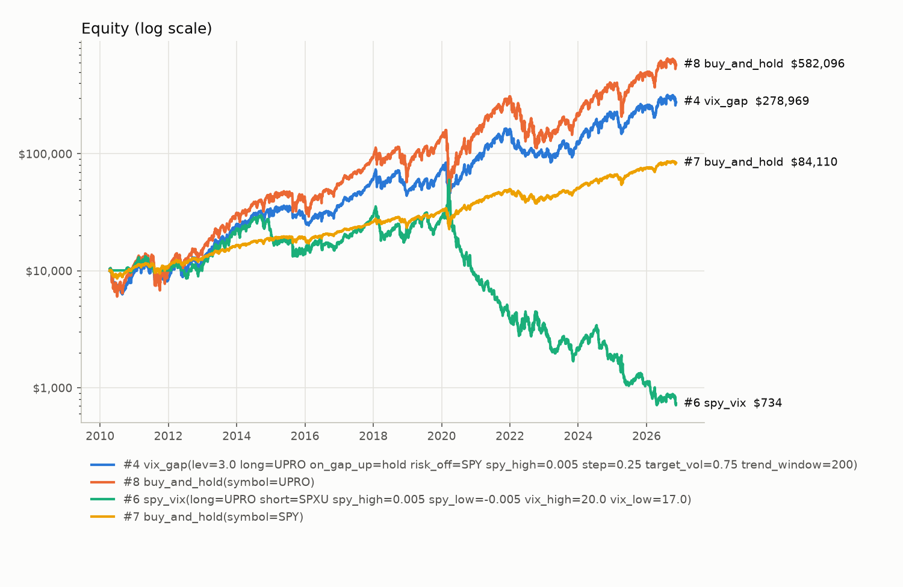
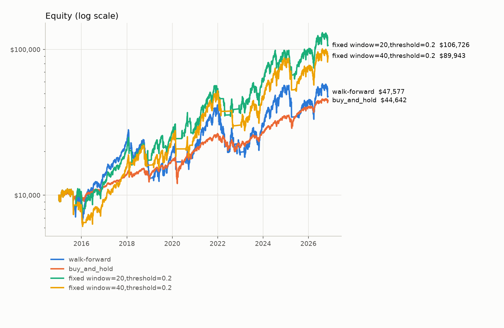

# Research notes: improving the SPY/VIX strategy

*November 2026. Data: Yahoo daily bars from April 2010 to November 2026, with prices adjusted for splits and dividends. All results include 5 bps slippage per fill unless stated otherwise.*

## Part 1: Is the approach feasible? (the oracle test)

**The goal:** each morning, go long (UPRO), short (SPXU) or to cash on the S&P 500, then hold until the next morning's rebalance. Holding overnight avoids same-day round trips, so this isn't day trading.

**The question:** before searching for an indicator, would this approach pay off if the indicator were right? And how right does it need to be?

```sh
uv run trading feasibility --start 2010-04-13 --measure spy_vix --measure spy_vix:short= --plot docs/img/feasibility.png
```



### Answer: the approach is feasible, but the bar for the indicator is high

**With perfect foresight the approach is extraordinarily profitable.**

| Apr 2010 – Nov 2026 | CAGR | Max drawdown | Sharpe |
|---|---|---|---|
| Hold SPY | 13.7% | −32% | 0.86 |
| Hold UPRO | 27.7% | −75% | 0.74 |
| Perfect oracle, long / cash | ~1,500% | −2% | 9.5 |
| Perfect oracle, long / short | ~17,000% | −4% | 14.3 |

These perfect-oracle results use the real UPRO and SPXU prices, so leveraged-ETF decay, fees and 5 bps slippage are all included. The vehicle itself works: nothing about the UPRO/SPXU mechanics or daily rebalancing prevents profit.

**With imperfect foresight, the required accuracy is the real hurdle.** I simulated 500 random indicators at each accuracy level. Accuracy here is *balanced* accuracy: the average of the up-day hit rate and the down-day hit rate. SPY rises on 56% of days, so "always long" looks 56% accurate while knowing nothing; on balanced accuracy, always-long and coin flips both score exactly 50%.

| Median indicator must be at least... | long / short | long / cash |
|---|---|---|
| ...to break even | 52.4% | 48.9% |
| ...to beat holding SPY (13.7%/yr) | 53.5% | 51.3% |
| ...to beat holding UPRO (27.7%/yr) | 54.6% | 53.3% |

What this shows:

1. **Long / cash is the better design unless the indicator is exceptional.** Long / cash beats long / short at every accuracy below about 56%, with smaller drawdowns. Shorting only pays once the indicator is above about 56%.
2. **Drawdowns stay brutal at realistic accuracy.** At 54%, the median long / short indicator still suffers a −78% max drawdown, and long / cash −56%. Even a genuinely good daily indicator, on 3x leverage, means riding deep losses.
3. **Daily direction indicators are rarely that good.** Sustained balanced accuracy of 53–55% for next-day S&P direction would be an exceptional result. Most published daily signals fall well short of it once costs are included, so treat any backtest claiming it with suspicion.

### Verdict: VIX fails as a direction indicator (closed)

> **Decision (2026-11-13):** VIX is rejected as the direction indicator for this strategy, and this line of research is closed.
> - **As a direction call:** no VIX rule tested, including the original, beat a coin flip at predicting the next day's direction.
> - **As a stay-in-or-cash filter:** it also lost to the simpler alternative. "Long UPRO only while VIX < 20" earned 11.8% (train) and 3.6% (test) a year, while "long only while SPY's own 20-day realized volatility < 20%" earned 29.1% and 21.6% (Part 3).
>
> VIX remains available as a sizing input (Part 2), but there's no evidence it beats realized volatility there either.

### Is VIX the right indicator? Measured: no, not for direction.

| Indicator (call "up" when...) | Balanced accuracy |
|---|---|
| always (always long) | 50.00% |
| VIX < 15 | 50.78% |
| VIX < 20 | 50.61% |
| VIX < 25 / < 30 | 50.23% / 50.06% |
| contrarian: VIX > 20 | 49.36% |
| VIX below VIX3M (no backwardation) | 50.17% |
| VIX fell overnight | 50.09% |
| SPY gap ≤ +0.5% | 50.88% |
| **original `spy_vix` rule** | **50.29%** |

Every VIX rule sits at 50–51%, indistinguishable from a coin flip and far below the roughly 53.5% needed to beat SPY. The original rule's −99% result came from two things: no directional information, plus a short leg that loses money on average because the market drifts up.

VIX does carry information about **how much** the market will move, not **which way** (see Part 2). That makes it a sizing input, not a direction signal.

### How the test works, and its limits

- The model matches the backtester: positions are decided at the open and held until the next open, and each switch pays slippage on the exit and the entry. A test confirms that the fast simulator and the real engine produce the same equity on identical positions.
- The random indicators are wrong on independent days. Real indicators tend to be wrong in streaks, which widens the range of outcomes and usually lowers the median for the same accuracy. Read the break-even numbers as optimistic minimums.
- Balanced accuracy counts every day equally. An indicator that is right on the *big* days can be worth more than its accuracy suggests, and one that is right only on small days can be worth less. When measuring a new indicator, check its actual backtest as well as its accuracy (`--measure` reports both).

### Recommended next step

Use `trading feasibility --measure <strategy>` as a gate: measure any candidate indicator's balanced accuracy **before** tuning it. If it isn't clearly above about 52% on 2010–2019 and still above it on 2020+, more tuning won't fix it.

---

## Part 2: Improving the original strategy

## TL;DR

- **The original `spy_vix` lost about 99% of its value.** Almost all of the damage came from its short leg: holding SPXU when VIX was above 20.
- **High VIX predicts violent markets, not falling ones.** Average UPRO returns were *highest* on days when VIX was 30 or more. VIX is useful for position **sizing**, not for picking direction.
- **The SPY-gap idea is real but small.** UPRO did poorly after gap-up opens and well after gap-down opens, in both the training and test periods. After trading costs, though, it adds almost nothing.
- **Nothing tested beat buy-and-hold SPY on risk-adjusted return** (Sharpe), in or out of sample.
- **The best trade-off found is `vix_gap` with a 200-day trend filter and VIX-based sizing.** It made about 22% a year against SPY's 14%, with a −50% max drawdown against UPRO's −77%. It held up on data it was not tuned on.



| Run (Apr 2010 – Nov 2026, 5 bps) | CAGR | Max drawdown | Sharpe | Trades |
|---|---|---|---|---|
| #6 original `spy_vix` | −14.6% | −98.8% | −0.11 | 287 |
| #7 buy-and-hold SPY | 13.7% | −33.7% | 0.84 | 1 |
| #8 buy-and-hold UPRO | 27.8% | −76.8% | 0.74 | 1 |
| **#4 `vix_gap` candidate** | **22.3%** | **−50.2%** | **0.74** | 232 |

Candidate params: `trend_window=200 risk_off=SPY target_vol=0.75 on_gap_up=hold`. Everything else is at its default.

## Method

To avoid overfitting, all parameter choices were made on **2010–2019 (train)**, and **2020–2026 (test)** was only used to check them. If you pick parameters by looking at test results, the test period silently becomes training data.

### Step 1: Diagnose before tuning

This step needs no strategy code. For each trading day, UPRO, SPXU and SPY returns were measured from that day's open to the next day's open. The days were then grouped by conditions that are known at the open. Script: an ad-hoc pandas analysis; see "Reproducing" below.

| Condition at the open | UPRO Sharpe, train | UPRO Sharpe, test | SPXU Sharpe, train / test |
|---|---|---|---|
| All days | 0.87 | 0.65 | −0.92 / −0.67 |
| VIX < 15 | 0.88 | 0.85 | −0.92 / −0.60 |
| VIX 20–25 | 1.98 | 1.02 | −1.95 / −0.97 |
| VIX 30+ | 2.04 | 1.46 | −2.24 / −1.87 |
| SPY gapped **down** > 0.5% | 1.45 | 1.26 | −1.47 / −1.29 |
| SPY gap flat | 1.16 | 0.65 | −1.18 / −0.60 |
| SPY gapped **up** > 0.5% | −0.26 | 0.10 | 0.13 / −0.20 |
| SPY below its 200-day average | 1.74 | 0.55 | −1.76 / −0.79 |

What this shows:

1. **SPXU had negative returns in nearly every condition.** There was no setup in which shorting paid reliably.
2. **High VIX came with *higher* average UPRO returns, but also enormous volatility**: UPRO's annualized volatility was about 95% in training and 120% in testing when VIX was 30+. With 3x leverage, volatility itself destroys compounded returns (volatility drag). That argues for **holding less when VIX is high**, not for shorting.
3. **The gap effect showed up in both periods.** It's the part of the original idea worth keeping.

### Step 2: Sweep with a train/test split

```sh
uv run trading sweep -s spy_vix -g short=SPXU, -g vix_high=20,25,30
uv run trading sweep -s vix_gap -g target_vol=0,0.3,0.45,0.6,0.75 -g on_gap_up=hold,cash -g spy_high=0.0025,0.005,0.01
uv run trading sweep -s vix_gap -g trend_window=0,200 -g risk_off=,SPY -g target_vol=0,0.45,0.6,0.75 -g on_gap_up=ignore,hold
```

What the sweeps found:

- **Original `spy_vix`:** every variant with the SPXU leg collapsed in the test period, with Sharpe between −0.61 and 0.11. Removing the short helps but doesn't rescue it.
- **Trading the gap daily (`on_gap_up=cash`)** produced about 1,000 trades per period. Slippage consumed most of the edge: test Sharpe was 0.34–0.63, against SPY's 0.79.
- **VIX sizing alone** cut drawdowns roughly in proportion to returns, so Sharpe stayed about the same.
- **Trend filter + VIX sizing + SPY when risk-off** was the most stable family. The chosen combination went from a training Sharpe of 0.77 to a test Sharpe of 0.71, and from 22.7% to 21.7% CAGR. It degraded the least of all the candidates.

## Caveats (read before trusting any number above)

- **Cash earns 0% in the backtester.** In reality, idle cash in a brokerage account earns interest (about 4–5% a year recently). Strategies that sit in cash are understated, most of all the variants with `risk_off=` (cash).
- **One train/test split is weak evidence.** 2020–2026 is a single path. A walk-forward analysis, which re-tunes and re-tests over several rolling windows, is the next step.
- **Fills at the open are idealized.** Real orders fill after the open, and Phase D will measure real slippage. Leveraged ETFs also carry expense ratios and financing costs, which their prices already reflect.
- **The VIX "open" is its first calculated value**, which can be noisy. A live implementation should read VIX a few minutes after 9:30.
- **The −50% max drawdown is a real number.** It happened in 2020 and 2022. Any live allocation has to be sized so a drawdown like that is survivable.

## What "better" means is still an open decision

On risk-adjusted terms, a plain SPY index fund is hard to beat, and nothing here did. Leveraged strategies are a choice to take on more risk for more return. The candidate strategy makes that choice more carefully than holding UPRO outright.

Which objective should drive the next round of research?

| Objective | Implication |
|---|---|
| Best risk-adjusted return (Sharpe) | Hold SPY, or study blends of SPY with cash or bonds. |
| Maximum growth within a drawdown limit (for example −35%) | Tune `vix_gap` sizing toward that limit, and add a drawdown constraint to the sweep. |
| Maximum growth, drawdowns acceptable | UPRO-heavy variants. The trend filter mostly reduces pain without giving up much return. |

## Next steps

1. Walk-forward analysis across rolling windows (2010–14 → 2015, 2010–15 → 2016, and so on).
2. Credit interest on cash, as a parameter: `--cash-rate`.
3. Measure the strategy against the objective chosen above, for example "highest CAGR subject to max drawdown ≥ −35%".
4. Candidate ideas, each tested the same way:
   - VIX term structure (VIX/VIX3M; the data is already wired in as `VIX3M`);
   - realized-volatility sizing instead of VIX;
   - a bond or T-bill ETF instead of SPY for the risk-off asset.

## Reproducing

```sh
docker compose -f deploy/docker-compose.yml up -d && uv run trading db upgrade
uv run trading backtest -s vix_gap -p trend_window=200 -p risk_off=SPY -p target_vol=0.75 --slippage-bps 5
uv run trading backtest -s buy_and_hold -p symbol=UPRO --start 2010-04-13 --slippage-bps 5
uv run trading backtest -s spy_vix --start 2010-04-13 --slippage-bps 5
uv run trading backtest -s buy_and_hold --start 2010-04-13 --slippage-bps 5
uv run trading runs show <ids> --plot docs/img/candidate_vs_original.png
```

---

## Part 3: Traditional timing indicators (screen, 2026-11-13)

**The question:** are there standard indicators for long/cash strategies that do better than VIX?

Each indicator below was run unchanged, with textbook parameters and **no tuning**, as a long-UPRO-or-cash rule. It decides at the open using only yesterday's close and earlier, and holds until the next open, with 5 bps slippage. Train is Apr 2010 – 2019; test is 2020 – Nov 2026. Reproduce with `uv run python research/screen_indicators.py`.

| Long UPRO when..., else cash | Balanced acc. (train / test) | CAGR train | CAGR test | Max DD train | Max DD test | Sharpe test | Switches/yr |
|---|---|---|---|---|---|---|---|
| *hold SPY (reference)* | | 13.0% | 14.7% | −20% | −32% | 0.82 | 0 |
| *always long UPRO (baseline)* | 50.0 / 50.0% | 31.3% | 22.7% | −55% | −75% | 0.65 | 0 |
| **Trend following** | | | | | | | |
| price > 200-day SMA (Faber 2007) | 49.6 / 51.2% | 13.8% | 20.9% | −59% | −51% | 0.68 | 5 |
| price > 200-day SMA, ±2% band | 50.1 / 50.9% | 19.5% | 19.6% | −47% | −54% | 0.65 | 2 |
| price > 100-day SMA | 50.1 / 51.8% | 15.7% | 27.6% | −47% | −46% | 0.83 | 10 |
| price > 50-day SMA | 49.7 / 51.3% | 6.0% | 14.5% | −54% | −50% | 0.55 | 17 |
| 50-day SMA > 200-day ("golden cross") | 50.5 / 50.4% | 16.2% | 10.5% | −49% | −75% | 0.45 | 1 |
| 12-month momentum > 0 (time-series momentum) | 49.7 / 51.5% | 21.7% | 14.9% | −55% | −68% | 0.54 | 4 |
| MACD above its signal line | 50.2 / 48.5% | 11.1% | 10.0% | −40% | −43% | 0.45 | 22 |
| **Volatility regime** | | | | | | | |
| **20-day realized vol < 20%** | 50.7 / 50.6% | **29.1%** | **21.6%** | **−36%** | **−38%** | 0.71 | 5 |
| 20-day realized vol < 15% | 50.4 / 49.6% | 14.5% | 14.9% | −37% | −29% | 0.63 | 6 |
| 20-day realized vol < 25% | 50.3 / 50.9% | 27.6% | 26.9% | −51% | −46% | 0.77 | 2 |
| VIX open < 20 | 50.7 / 50.3% | 11.8% | 3.6% | −48% | −38% | 0.27 | 15 |
| VIX open < 25 | 50.5 / 49.8% | 27.8% | 13.3% | −51% | −55% | 0.53 | 9 |
| **Short-term mean reversion** | | | | | | | |
| yesterday was a down day | 49.7 / 49.8% | 3.1% | 14.6% | −52% | −61% | 0.53 | 127 |
| RSI(2) < 30 (Connors-style oversold) | 49.7 / 51.2% | 5.0% | 26.1% | −50% | −42% | 0.81 | 63 |
| RSI(2) < 30 and price > 200-day SMA | 50.0 / 51.7% | 0.4% | 18.0% | −40% | −37% | 0.86 | 52 |
| **Calendar** | | | | | | | |
| turn of the month (last day + first 3) | 49.3 / 50.6% | 0.0% | 15.1% | −44% | −29% | 0.70 | 24 |

### Findings

1. **No traditional indicator predicts daily direction either.** Every one scores 48.5–51.8% balanced accuracy, below the roughly 52–53% the oracle test says is needed. This is consistent with markets being close to unpredictable day to day.
2. **Their value is avoiding the worst periods, not calling direction.** A trend or volatility filter is wrong about as often as it's right on ordinary days. Its benefit comes from being out of the market during the few violent stretches (2011, 2015–16, 2018, 2020, 2022) that cause most of a 3x fund's drawdown. Balanced accuracy can't see this, so judge these filters by drawdown and consistency.
3. **Realized volatility < 20% is the standout because it was consistent.** It kept roughly 93% of UPRO's training return and 95% of its test return, while cutting max drawdown from −55% to −36% (train) and −75% to −38% (test). The nearby thresholds (15%, 25%) behave sensibly too, so the result isn't a fluke of one number. This matches the research on volatility-managed portfolios (Moreira & Muir 2017): volatility clusters, and high-volatility periods have poor risk-adjusted returns, worst of all with daily-reset leverage.
4. **Some popular indicators did badly here.** The golden cross, MACD and 12-month momentum were either too slow (they exited after the damage and re-entered late) or too noisy. Their test drawdowns (−68% to −75%) were close to simply holding UPRO (−75%), so they gave little protection when it mattered.
5. **Big jumps between train and test usually mean luck, not edge.** RSI(2), "yesterday was a down day" and the 100-day SMA jump from weak train results to strong test results. That's what a period-specific fluke looks like, so don't select them on the test numbers.
6. **Still nothing beats SPY's Sharpe consistently.** The best leveraged filters reach about SPY's Sharpe (0.7–0.8) at roughly 1.5–2x SPY's return, with deeper (but survivable) drawdowns.

### Recommended next step

Build a `vol_filter` strategy: long UPRO while SPY's 20-day realized volatility is below a threshold, else cash, optionally combined with a slow trend filter. Then put it through the same process as everything else:

1. `sweep` the threshold and window on 2010–2019 only;
2. check the result on 2020+;
3. run a walk-forward test before it goes anywhere near shadow trading.

Also credit interest on cash. These filters sit in cash for 10–35% of days, so they're currently understated.

---

## Part 4: Would intraday exits help? (2026-11-13)

**The question:** if day-trading restrictions loosen, does exiting during the day improve the strategy? Reproduce with `uv run python research/intraday_exits.py`.

> Note on the rules: I haven't verified the current status of FINRA's pattern-day-trader rule, which applies to margin accounts. Confirm with Schwab. Cash accounts were never subject to it, though they are subject to settlement rules. In this strategy, a stop-loss that sells shares bought the same morning **is** a day trade; the "overnight only" variant below is **not**.

### Where the return comes from

| Annual return | SPY session (open→close) | SPY overnight (close→next open) | UPRO session | UPRO overnight |
|---|---|---|---|---|
| Train 2010–19 | 4.0% | **8.7%** | 5.9% | **24.1%** |
| Test 2020–26 | 5.1% | **9.2%** | 5.7% | **16.1%** |

Most of the gain came overnight, a well-documented pattern (the "overnight effect"). The trading session, the part that intraday exits would let you skip or cut short, contributed relatively little.

### Variants tested

The table uses 5 bps slippage, plus 10 bps extra on stop fills. Stops are simulated from the daily low: if UPRO traded X% below that morning's open, the position exits at that price and stays in cash until the next open.

| Strategy | CAGR train | CAGR test | Max DD train | Max DD test |
|---|---|---|---|---|
| Always long UPRO, open → next open | 31.3% | 22.7% | −55% | −75% |
| ... + 3% stop | 19.3% | 27.9% | −56% | −54% |
| ... + 5% stop | 23.1% | 25.1% | −52% | −63% |
| ... session only | −17.7% | −17.8% | −90% | −78% |
| ... overnight only | −3.6% | −9.7% | −53% | −71% |
| **Realized vol < 20% filter, open → next open** | **29.1%** | **21.6%** | **−36%** | **−38%** |
| ... + 2% stop | 13.0% | 14.9% | −50% | −38% |
| ... + 5% stop | 30.1% | 20.8% | −34% | −37% |
| ... session only | −10.4% | −19.6% | −72% | −79% |
| ... overnight only | −6.4% | 2.1% | −56% | −43% |
| ... overnight only, at 1 bp slippage | 11.3% | 19.6% | −43% | −32% |

### Findings

1. **Intraday exits don't robustly improve the strategy.** Tight stops (2–3%) mostly sell intraday dips that recover. They hurt in 2010–2019 and only looked good in 2020–2026 on plain UPRO, which is a period-specific result. A 5% stop on the filter strategy is roughly neutral.
2. **Session-only trading loses money in every version.** It keeps the weak part of the return and pays for two fills a day.
3. **Overnight-only is the one idea with something behind it**, but it needs very low costs. It means about 500 fills a year, so 5 bps per fill erases it. At about 1 bp, which is plausible with market-on-close and market-on-open auction orders, the filter version reached 19.6% in test with a −32% drawdown, but only 11.3% in train. It needs a closer look with real auction-fill costs before it's taken seriously. It requires no day trades.
4. **The stop results are optimistic.** Real stop orders on leveraged ETFs can fill far below their trigger in fast markets; during the August 24, 2015 open, many ETF stops executed far below their stop prices.

### Verdict

Keep the daily open → next open design. The risk control that works, the volatility filter, operates at daily frequency. Intraday ability is still valuable for **operations**: an emergency exit and the kill switch in Phase D. Intraday *strategies* would need years of minute-level data, and Schwab keeps only a short window of it, so they'd need a paid data source.

---

## Part 5: The volatility filter as a strategy (2026-11-13)

`strategies/vol_filter.py`: hold UPRO while SPY's realized volatility over the last `window` days is below `threshold`, otherwise hold cash. There's an optional trend filter and an optional risk-off asset.

**Change to the backtester:** idle cash now earns the historical 13-week T-bill yield (`--cash-rate tbill`, now the default), or any fixed rate you pass. Rates ranged from about 0% (2010–15, 2020–21) to about 5% (2023–24). Runs record which cash rate they used.

### Tuning on 2010–2019, checking on 2020–2026

```sh
uv run trading sweep -s vol_filter -g window=10,20,40,60 -g threshold=0.15,0.175,0.2,0.225,0.25,0.3 -g trend_window=0,200
```

The best training Sharpe went to window 20 / threshold 20% (train 28.8%, −35%; test 22.0%, −38%, Sharpe 0.73) and window 40 / 20%. But neighboring settings swing a lot. For example, 20 / 22.5% looked fine in train and then made 15.8% with a −59% drawdown in test. Adding the 200-day trend filter never improved training results.

### Walk-forward: does re-tuning every year help? No.

Each year from 2015, the walk-forward picked the combination with the best Sharpe on all prior years and traded the next year with it.

```sh
uv run trading walkforward -s vol_filter -g window=10,20,40,60 -g threshold=0.15,0.175,0.2,0.225,0.25,0.3 \
    -g trend_window=0,200 --reference window=20,threshold=0.2 --reference window=40,threshold=0.2 \
    --plot docs/img/vol_filter_walkforward.png
```



| Jan 2015 – Nov 2026, 5 bps, T-bill cash | CAGR | Max drawdown | Sharpe |
|---|---|---|---|
| Hold SPY | 13.5% | −34% | 0.81 |
| Hold UPRO | 24.4% | −77% | 0.68 |
| **vol_filter, re-tuned yearly (walk-forward)** | 14.1% | −56% | 0.54 |
| **vol_filter, fixed 20-day / 20%** | **22.1%** | **−38%** | **0.74** |
| vol_filter, fixed 40-day / 20% | 20.4% | −47% | 0.70 |

1. **Re-tuning hurt.** The yearly choice changed six times in 12 years, each time chasing whatever had worked recently, and it badly underperformed every fixed setting. The parameter landscape is too noisy for the best past setting to predict the best future one.
2. **A fixed, round-number setting did best: 20 trading days, roughly one month, and a 20% volatility threshold.** It made about 90% of UPRO's return (22.1% vs 24.4% a year) with half the max drawdown (−38% vs −77%). It is the best result in this research so far.
3. **Be honest about how 20 / 20% was chosen.** It was picked as a textbook default *before* any tuning (the Part 3 screen), not optimized. But I have since seen its full-period results, so it isn't a perfectly clean out-of-sample result either. The best defense is that it's the obvious round-number choice, and that 15%, 25% and 40-day versions behave similarly, if a bit worse.
4. **It roughly ties SPY on Sharpe; it doesn't beat it.** Over 2015–2026 it scored 0.74 vs SPY's 0.81. Over the full Apr 2010 – Nov 2026 period (run #9: 26.2% CAGR, −38% max drawdown, in the market 83% of days) it scored 0.84, exactly SPY's 0.84. What it offers is about 1.6–1.9x SPY's annual return, for a max drawdown about 5 percentage points deeper than SPY's (−38% vs −34%) and about 2x SPY's day-to-day volatility.

### Recommendation

Adopt **`vol_filter` with fixed defaults (window 20, threshold 20%, cash when off)** as the strategy to carry into Phase D (shadow trading), and **don't re-tune it on a schedule**. Treat the parameters as fixed policy. Only revisit them for a structural reason, never because of a recent bad stretch.

Known risks to watch in shadow trading:

- **Gap risk.** A crash that arrives without warning, while volatility is still low (for example February 2018 or February 2020), hits a full 3x position before the filter reacts. Most of this strategy's −38% max drawdown comes from moments like these.
- **Whipsaws.** About 4–5 trades a year (74 over Apr 2010 – Nov 2026), so costs are small, but each switch happens on a volatile day. Real fills will show whether 5 bps per trade was realistic.
- **This rests on one main historical path (2010–2026).** A long, grinding bear market with *low* volatility (rare, but possible) would be its weak spot.

---

## Part 6: Options-market indicators, gamma exposure and expected move (2026-11-13)

**The hypothesis:** SPY's options market is so large that it drives the underlying.
- **Expected move:** the price of 0-DTE ATM straddles shows the range the market expects for the day.
- **Gamma exposure (GEX):** dealer hedging is positive (buy dips, sell rips → calm, mean-reverting markets) or negative (sell into weakness → trend days and sell-offs).

Reproduce with `uv run python research/options_indicators.py`.

### Data, and the limits of free data

Historical option chains (and so true historical 0-DTE straddle prices) aren't freely available; Yahoo and the Schwab API return only *current* chains. The tests use the best free proxies:

| Concept | Proxy used | History |
|---|---|---|
| GEX | SqueezeMetrics' published daily S&P 500 GEX estimate (end of day; day t−1 is used at day t's open) | May 2011 → |
| 0-DTE expected move | Cboe **VIX1D** (1-day implied vol from SPX options): EM = SPY × VIX1D / 100 / √252. An ATM straddle costs about 0.8 × EM. | Apr 2023 → |
| Short-horizon expected move | Cboe **VIX9D** (9-day implied vol), same formula | 2011 → |

### A. GEX: the volatility part of the claim holds; the direction part doesn't

| Yesterday's GEX | Days (train / test) | Next-day avg \|move\| | Intraday range | Worst 5% day | Next-day avg return | Reversal corr. |
|---|---|---|---|---|---|---|
| **Negative**, train 2011–19 | 155 | 1.29% | 2.03% | −2.40% | +0.22% (t = 1.7) | −0.07 |
| Positive, train | 2,026 | 0.57% | 0.91% | −1.29% | +0.04% (t = 2.2) | 0.00 |
| **Negative**, test 2020–26 | 193 | 1.61% | 2.56% | −3.26% | +0.08% (t = 0.5) | −0.11 |
| Positive, test | 1,532 | 0.72% | 1.10% | −1.70% | +0.06% (t = 2.4) | −0.07 |

"Reversal corr." is the correlation between yesterday's move and today's open→close move. Negative means mean reversion; positive means trending.

1. **Confirmed: GEX forecasts the *size* of moves, strongly and consistently.** After negative-GEX days, the next day's moves were about 2.2x larger and the worst days roughly 2x worse, in both periods. Across GEX quintiles the effect is close to monotonic (train next-day |move|: 1.10% → 0.67% → 0.51% → 0.46% → 0.36%). GEX also adds information beyond realized volatility: even in calm markets (20-day realized vol < 20%), negative-GEX days moved 1.05% on average vs 0.57%.
2. **Not supported: negative GEX → sell-offs.** Average next-day returns after negative GEX were *positive* (+0.22% train, +0.08% test). Bigger moves came in both directions, with sharp rebounds as common as continued selling. No direction call can be made from it.
3. **Not supported: negative GEX → trend days, positive GEX → mean reversion.** If anything it's the reverse: negative-GEX days showed slightly *more* reversal (−0.07 / −0.11), and positive-GEX days were neutral (0.00 / −0.07). The effects are small either way.

### B. Expected move: the market over-prices the range, and breakouts don't predict direction

| | Days | Avg expected move | Session (open→close) inside ±EM | Fair 1σ would be |
|---|---|---|---|---|
| VIX1D (0-DTE proxy), 2023–26 | 893 | 0.70% | **75%** | 68% |
| VIX9D, 2011–26 | 3,906 | 1.12% | 90% | 68% |

- Options consistently price a **wider** range than actually happens: the median realized move was 0.61x the VIX1D expected move. This is the well-known volatility risk premium, the reason option sellers earn money on average. As a *risk estimate* the expected move is conservative, which is fine; as a direction signal it says nothing by construction, because a straddle is symmetric.
- **Breakouts:** after the session closed beyond ±EM, the next day's average return was statistically indistinguishable from normal days.
  - After an up-breakout: −0.01% to +0.04%, t < 0.3.
  - After a down-breakout: −0.02% in train vs +0.27% in test, with the sign flipping between periods. Neither "breakout continuation" nor "breakout reversal" is a reliable signal.

### C. As long-UPRO / cash indicators (5 bps per fill)

| Long UPRO when..., else cash | Balanced acc. (train / test) | CAGR train | CAGR test | Max DD train | Max DD test | Sharpe test |
|---|---|---|---|---|---|---|
| always long UPRO | 50.0 / 50.0% | 30.7% | 22.7% | −53% | −75% | 0.65 |
| GEX > 0 | 49.9 / 50.8% | 18.5% | 24.9% | −57% | −58% | 0.72 |
| GEX above its trailing 1-year median | 50.3 / 48.6% | 9.4% | −3.6% | −34% | −48% | 0.03 |
| **realized vol < 20% (current candidate)** | 50.5 / 50.6% | **27.5%** | **21.6%** | **−35%** | **−38%** | 0.71 |
| realized vol < 20% AND GEX > 0 | 50.8 / 50.8% | 23.9% | 18.6% | −44% | −40% | 0.66 |
| realized vol < 20% OR GEX > 0 | 49.6 / 50.7% | 22.0% | 28.0% | −55% | −62% | 0.77 |

*(Cash earns 0% in this table, so filters that hold cash are slightly understated relative to Part 5.)*

- **No options indicator predicts direction:** balanced accuracy is 48.6–50.8%, a coin flip, like every other indicator tested.
- **GEX doesn't improve the volatility filter as an on/off switch.** Exiting on negative GEX misses the sharp rebounds that follow those days (point A2), so it lowers returns without consistently cutting drawdowns. No combination beat `vol_filter` in both periods.

### Verdict

- **Direction: rejected**, for both GEX and expected move.
- **Volatility: GEX is a genuinely good forecaster**, possibly the best one tested. Its natural use is **position sizing** (holding less UPRO when GEX is negative), not an on/off switch. That's worth one follow-up test, for example 1/3 weight when GEX < 0. It would need careful handling, because negative-GEX days also carry the best average returns.

### Caveats

- SqueezeMetrics' GEX is a **model estimate**: dealer positioning is inferred from open interest under assumptions about who is long or short. It isn't directly observed. The history was downloaded today, and I can't verify whether past values were ever revised.
- VIX1D covers only 3.5 years. 0-DTE trading has grown so much since 2022 that pre-2022 behavior may not represent today's market.
- **The way to test the real thing:** the Schwab API's `option_chains` endpoint gives live chains. A daily collector job (Phase D) could snapshot SPY's 0-DTE chain at the open, compute the ATM straddle and our own GEX estimate, and store them in Postgres. After 6–12 months there'd be first-hand data to test these ideas directly, rather than through proxies.

---

## Part 7: Random-forest direction model, VIX features (2026-11-13)

**The idea:** compute a set of indicators, feed them to a random forest classifier, use its confidence P(SPY up until tomorrow's open) as the signal, and hold UPRO only when that confidence clears a threshold. The intended indicators are VIX, NYSE ADD (advance/decline) and NYSE TICK.

- Strategy: `strategies/rf_direction.py`
- Features and training: `trading/ml.py`
- Evaluation: `uv run python research/rf_direction.py`

### Data: only VIX is available for free

| Indicator | Free daily history | Status |
|---|---|---|
| VIX | 1990 → (Yahoo) | Used |
| NYSE ADD | Unicorn Research daily A/D files, **but that site stopped updating in Feb 2020**, which leaves no test period | Later found: **Schwab `$ADD` daily, Aug 2012 →** (see "Adding market internals" below) |
| NYSE TICK | None | Later found: **Schwab `$TICK` daily, Mar 2006 →** (see below) |

The feature code already supports `ADD` and `TICK` when a data source provides them (`-p internals=ADD,TICK`). A leakage test covers them too.

**Data-quality finding:** Yahoo's VIX *opens* for 2008–2009 are mostly stale. About 30% equal the prior close, and the median overnight gap is about 0.2%, versus about 2% in every other year. Open-based VIX features are masked for those two years, and those rows are excluded from training.

### Model and features

**Model:** a deliberately regularized random forest: 300 trees, max depth 4, at least 50 samples per leaf. It is **retrained every January on all prior data from 1996**, so every prediction is out of sample. That gives about 3,000 training rows for 2010, growing to about 7,100 for 2026.

**Features** (15 in total), all known at the open:
- **VIX:** level at the open; morning gap versus the prior close (a spike or drop); 1- and 5-day change; distance from its 20-day average.
- **VIX/SPY divergence:** the VIX move beyond what SPY's move implies, using a rolling 120-day beta, for both the morning gap and the prior day ("SPY flat but VIX rising").
- **SPY context:** gap; 1-, 5- and 20-day returns; distance from the 200-day average; 20-day realized volatility; prior day's range.

### Results (out of sample, 2010–2026)

| | 2010–2019 | 2020–2026 |
|---|---|---|
| AUC (0.50 = no skill) | 0.503 (90% CI 0.485–0.522) | 0.500 (0.479–0.521) |
| AUC of the same model trained on **shuffled** labels | 0.497 | 0.492 |
| Balanced accuracy at P ≥ 0.5 | 50.8% | 50.4% |

**The confidence score has no information.** SPY's actual up-rate is flat across the model's confidence levels:

| Model's P(up), quintile | Avg. predicted | Actually up |
|---|---|---|
| lowest | 50.1% | 54.9% |
| 2 | 53.3% | 56.8% |
| 3 | 54.9% | 56.2% |
| 4 | 56.3% | 56.5% |
| highest | 58.9% | 55.3% |

**Higher thresholds make it worse** (long UPRO when P ≥ threshold, else cash; 5 bps):

| Rule | CAGR 2010–19 | CAGR 2020–26 | Max DD 2020–26 | Sharpe 2020–26 |
|---|---|---|---|---|
| always long UPRO | 32.7% | 22.7% | −75% | 0.65 |
| `vol_filter` | 28.9% | 21.6% | −38% | 0.71 |
| P ≥ 0.50 (in market about 93% of days) | 32.8% | 19.6% | −75% | 0.60 |
| P ≥ 0.55 | 6.5% | 3.4% | −74% | 0.31 |
| P ≥ 0.58 | −1.7% | −6.9% | −69% | −0.03 |

**Permutation importance on out-of-sample years:** shuffling any single feature changed AUC by at most 0.005. The top three were the VIX morning gap, SPY's 5-day return and the VIX/SPY gap divergence, each helping in only 10–11 of 17 years. That's indistinguishable from noise.

### Verdict

With VIX (and SPY) features, the random forest is **a coin flip, the same as every single indicator before it**. Combining weak indicators in a nonlinear model didn't create an edge, because none of them carries next-day direction information to begin with. The confidence score must not be used as an entry signal in this form.

### What could still change the answer: market internals, at the right time

The ADD and TICK ideas are *intraday* signals: breadth failing to confirm a rally, TICK not confirming SPY's new high of the day. At the **open**, today's internals don't exist yet. Only yesterday's end-of-day values do, and that's a much weaker version of the idea. Testing it properly means one of two things:

1. **Prior-day internals at the open** (no strategy change). Needs daily `$ADD` / `$TICK` history for 2010+. Run `trading feasibility --measure rf_direction:internals=ADD,TICK` once a source exists.
2. **Decide later in the morning** (for example 10:00 ET, after the opening divergences have formed), then hold until the next open, which is still not a day trade. This needs **intraday** ADD, TICK, VIX and SPY history, and the backtester would need an intraday decision time. That's a bigger change, and the paid data is unavoidable.

Either way, apply the same bar: out-of-sample AUC clearly above 0.52, confidence that actually rises with outcomes, and a better result than `vol_filter`, before anything goes to shadow trading.

### Adding market internals: Schwab daily `$ADD` / `$TICK` (2026-11-13)

After logging in to Schwab (`trading schwab auth`), `trading schwab check` showed how much history the API provides:

| Symbol | Daily candles | 1-minute candles |
|---|---|---|
| `$ADD` | Aug 2012 → (3,587 days) | about the last 10 days only |
| `$TICK` | Mar 2006 → (5,200 days) | about the last 10 days only |
| SPY / `$VIX` | 1993 / 1990 → | about the last 10 days only |

In Schwab's daily internals bars, **high and low are the session's extreme readings** and close is the end-of-day value. `$TICK` contains bad prints (values like 760,000, when NYSE TICK can't exceed about ±3,000), so any bar with a value over 4,000 is masked in `trading/ml.py`.

**Test:** the same random forest, with and without the 8 internals features. These cover prior-day ADD (level, change and 5-day mean), "rally without participation" (SPY up over 5 days while ADD's 5-day mean is negative), prior-day TICK close/high/low, and "TICK exhaustion" (SPY at a 5-day high while TICK's high lags its 5-day max). Both models used **identical days** (internals exist from Aug 2012), were retrained each January and scored out of sample from 2016. Reproduce with `uv run python research/rf_internals.py`.

| Out-of-sample AUC (90% CI) | 2016–2019 | 2020–2026 |
|---|---|---|
| VIX + SPY | 0.483 (0.454–0.513) | 0.477 (0.454–0.499) |
| **VIX + SPY + ADD + TICK** | **0.474 (0.446–0.506)** | **0.481 (0.460–0.503)** |
| Full model, shuffled labels | 0.483 | 0.507 |

| Internals model's P(up), quintile | Avg. predicted | Actually up |
|---|---|---|
| lowest | 51.1% | 59.6% |
| 2 | 55.0% | 57.7% |
| 3 | 56.4% | 55.7% |
| 4 | 57.9% | 55.9% |
| highest | 60.8% | 52.7% |

- **Internals add no skill.** Both models are within noise of a coin flip; their AUCs sit inside the range of the shuffled-label model.
- **Calibration runs slightly backwards.** The days the model was most bullish on were up *least* often. Inverting the model would mean choosing a direction after seeing the results, which is classic overfitting, and the effect sits at the edge of the noise range. It is recorded here, not acted on.
- **Every threshold underperformed holding UPRO or `vol_filter`.** At P ≥ 0.55, 2020–2026 returned −1.6%/yr, compared with 22.7% for UPRO and 21.6% for `vol_filter`.
- **Permutation importance:** all four TICK features had *negative* out-of-sample importance. ADD's 5-day mean helped in only 5 of 11 years.

### Verdict on `rf_direction`

**Rejected at the daily-open timescale, with VIX, SPY and prior-day internals.** The intraday form of the ADD/TICK ideas (divergences *during* the session, acted on by mid-morning) remains untested, because Schwab keeps only about 10 days of 1-minute history. The Phase D internals collector would build that history; revisit after about 12 months of collected data. The bar stays the same: out-of-sample AUC clearly above 0.52, and confidence that actually rises with outcomes.

---

## Part 8: Calendar and event effects, Track A (2026-11-13)

**The question:** do any effects that are known *in advance* predict SPY's direction well enough to improve `vol_filter`? The strongest candidate is the **pre-FOMC drift**: Lucca & Moench (2015) documented large S&P gains in the 24 hours before scheduled Fed announcements. Some later studies report that it has weakened.

- Reproduce with `uv run python research/calendar_effects.py`.
- FOMC dates come from `research/data/fomc_announcements.csv`: 143 scheduled announcement dates from 2010 to 2027, parsed from the Federal Reserve's calendar pages by `research/fomc_calendar.py`.
  - Unscheduled meetings, cancelled meetings, notation votes and conference calls are excluded.
  - Every year has 8 dates except 2020, which has 7 because its March meeting was cancelled.
  - All dates fall on trading days, and a test checks this.

**The bar:** about a dozen flags were tested, so a flag counts only if it is significant (|t| ≥ 2 against all other days) **with the same sign in both** 2010–19 and 2020–26.

### Results: SPY open → next-open return (the strategy's holding period). All days average +5.3 bps (2010–19) and +6.2 bps (2020–26).

| Flag | Days (train / test) | Avg. return, 2010–19 / 2020–26 | t vs. other days | Close→close, for comparison with the literature |
|---|---|---|---|---|
| **Day before FOMC** | 78 / 54 | **+12.2 / +14.3 bps** (up on 67% / 57% of days) | +0.90 / +0.73 | +1.7 / +5.7 bps |
| FOMC announcement day | 78 / 54 | −8.6 / −7.3 bps | −1.06 / −0.78 | **+11.1 / +11.0 bps** |
| Day after FOMC | 78 / 54 | −2.3 / −11.9 bps | −0.78 / −1.05 | −20.9 / −10.0 bps |
| Pre-holiday | 88 / 65 | +6.1 / +9.1 bps | +0.08 / +0.25 | |
| Options-expiration Friday | 115 / 79 | −8.1 / −19.4 bps | −1.39 / −1.65 | |
| Options-expiration week | 575 / 398 | +4.9 / −3.8 bps | −0.10 / −1.92 | |
| Last session of the quarter | 39 / 27 | +22.3 / +9.4 bps | +1.06 / +0.13 | |
| Monday | 459 / 322 | +0.1 / **+25.9 bps** | −1.35 / **+3.49** | |
| Tuesday to Friday | | between −0.7 and +8.9 bps | all \|t\| < 1.2 | |

**No flag passes.** In detail:

1. **The pre-FOMC drift points the right way but is too weak to rely on.** The day before an announcement averaged about 2.5x a normal day in both periods, but with only about 130 events and noisy daily returns, t < 1. The effect may be real, but the evidence can't distinguish it from luck.
2. **The FOMC-day gain happens before the open.** Measured close-to-close, announcement days gained +11 bps in both periods. But from the open to the next open they *lost* 7–9 bps. The gain arrives overnight and in the early morning, which a strategy deciding at the open can't capture. The day after FOMC tended to give some of it back.
3. **Options-expiration Friday was negative in both periods** (t −1.4 / −1.7). It's the closest to a consistent signal, but it falls short of the bar. Treat it as a hypothesis to recheck with more data, not a rule. Adopting it now would mean choosing a rule after seeing the results.
4. **The Monday effect exists only since 2020** (t +3.5 in 2020–26, nothing before). That's a period effect, which is exactly what the two-period rule is designed to filter out.

### As add-ons to `vol_filter` (forced long on flagged days even when the filter says cash; 5 bps)

| Variant | CAGR 2010–19 | CAGR 2020–26 | Max DD 2010–19 | Max DD 2020–26 | Sharpe 2010–19 | Sharpe 2020–26 |
|---|---|---|---|---|---|---|
| `vol_filter` | 29.1% | 21.6% | −36% | −38% | 0.92 | 0.71 |
| + long on pre-FOMC days | 28.0% | 23.9% | −39% | −38% | 0.89 | 0.76 |
| + long on FOMC days | 24.6% | 16.2% | −43% | −48% | 0.81 | 0.59 |
| + long on pre-FOMC and FOMC days | 23.7% | 18.6% | −47% | −45% | 0.79 | 0.64 |
| + long on pre-holiday days | 26.5% | 24.3% | −41% | −40% | 0.86 | 0.77 |

No add-on helps in both periods. The pre-FOMC and pre-holiday versions help only in 2020–26 and cost something in 2010–19. Forcing a position on high-volatility days, which is when `vol_filter` is in cash, also adds drawdown.

### Verdict

**Track A is closed. No change to `vol_filter`.** The calendar effects are too small and too noisy, and where they exist (the FOMC-day gain) they fall in the overnight hours before a decision at the open. If the strategy were ever redesigned to decide at the previous **close** (see Part 4, "overnight only"), the FOMC effect would be worth retesting with that timing.
